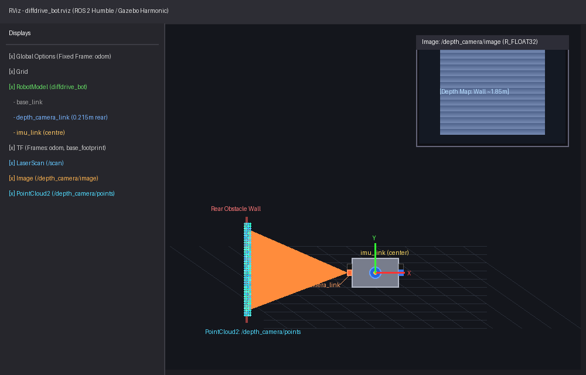
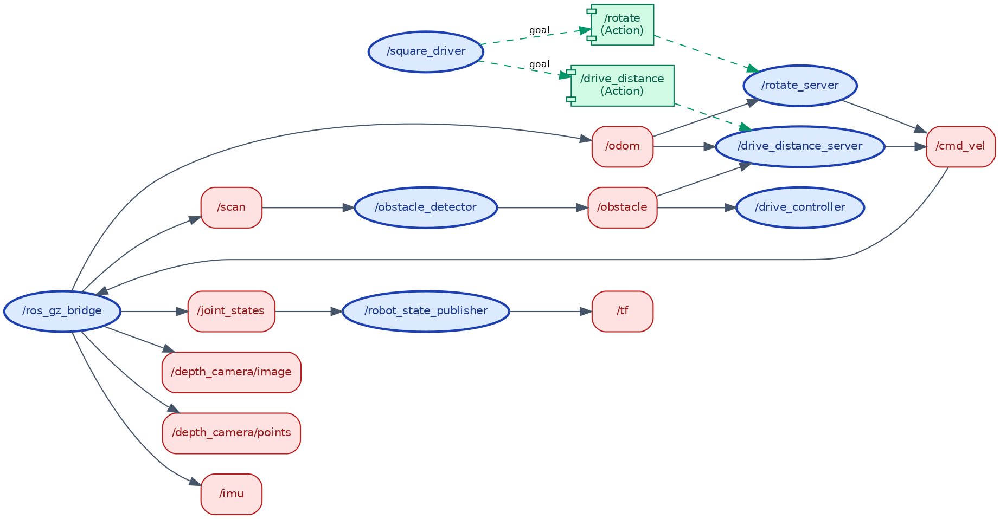

# Introduction to Robotics and Intelligent Systems - Lab 1 Exercise

**Course:** Introduction to Robotics and Intelligent Systems  
**Program:** BSc in Software Engineering, Addis Ababa University (AAU / SiTE)  
**Academic Year:** 2026  
**Lecturer & Lab Assistant:** Mohammed Sraj (MSc AI)  
**Repository:** [https://github.com/bisrat6/lab1_exercise](https://github.com/bisrat6/lab1_exercise)  

---

## Overview

This repository contains the complete implementation of **Lab 1: Program `diffdrive_bot`**. The project extends a simulated two-wheeled differential drive robot in **ROS 2 Humble** and **Gazebo Harmonic**, equipping it with additional sensors (a rear-facing depth camera and a central IMU), custom interfaces, autonomous obstacle avoidance with dynamic parameter tuning, an in-place rotation action server, and a synchronized square trajectory coordinator.

The repository is self-contained and structured as four interoperable ROS 2 packages that build together inside any ROS 2 workspace.

---

## Package Architecture

```
lab1_exercise/
├── diffdrive_bot/              # Robot description, Gazebo worlds, baseline nodes & bridge config
│   ├── config/bridge.yaml      # ROS-GZ topic bridge (Scan, Odom, TF, Depth Image, PointCloud2, IMU)
│   ├── launch/                 # gazebo.launch.py, control.launch.py, display.launch.py
│   ├── rviz/                   # RViz display configurations
│   ├── scripts/                # obstacle_detector.py, drive_controller.py, drive_distance_server.py
│   ├── urdf/                   # diffdrive_bot.urdf.xacro (URDF robot description)
│   └── worlds/obstacles.sdf    # Gazebo simulation world with physics & IMU system plugins
├── lab_interfaces/             # Course baseline message, service, and action definitions
│   ├── msg/ObstacleInfo.msg
│   ├── srv/SetSpeed.srv
│   └── action/DriveDistance.action
├── my_robot_interfaces/        # Custom student interface definitions (ament_cmake)
│   ├── msg/RobotStatus.msg     # State ("forward", "turning", "stopped") & obstacle distance
│   ├── srv/SetTurnSpeed.srv    # Dynamic turn speed service with validation
│   └── action/Rotate.action    # In-place angular rotation action
├── my_robot_nodes/             # Custom student robot behavior nodes & launch file (ament_python)
│   ├── my_robot_nodes/
│   │   ├── turn_away.py        # Obstacle avoidance node with dynamic params & services
│   │   ├── rotate_server.py    # Action server executing in-place rotations using odometry
│   │   └── square_driver.py    # Action client driving a 4-legged square trajectory
│   └── launch/
│       └── square.launch.py    # Master launch orchestrating simulation, servers, and client
├── docs/images/                # Verification screenshots (RViz & rqt_graph)
├── README.md                   # Lab walkthrough, instructions, and analysis
└── LICENSE                     # MIT License
```

---

## System Requirements

- **Operating System:** Ubuntu 22.04 LTS (native or WSL2)
- **Middleware:** ROS 2 Humble Hawksbill
- **Simulator:** Gazebo Harmonic (gz-sim 8)
- **Bridge Packages:** `ros-humble-ros-gzharmonic` (or `ros-humble-ros-gz`)

---

## Getting Started & Build Instructions

1. **Source the ROS 2 environment:**
   ```bash
   source /opt/ros/humble/setup.bash
   ```

2. **Clone / Place repository into your workspace `src` directory:**
   ```bash
   mkdir -p ~/ros2_ws/src
   cd ~/ros2_ws/src
   # Clone this repository as lab1_exercise
   git clone https://github.com/bisrat6/lab1_exercise.git lab1_exercise
   ```

3. **Build the packages with `colcon`:**
   ```bash
   cd ~/ros2_ws
   colcon build --symlink-install
   ```

4. **Source the local workspace overlay:**
   ```bash
   source install/setup.bash
   ```

---

## Step-by-Step Guide & Verification

### Step 1: Add Depth Camera and IMU to `diffdrive_bot`

1. **URDF Extensions (`diffdrive_bot/urdf/diffdrive_bot.urdf.xacro`):**
   - **Depth Camera:** Added `depth_camera_link` on the rear face of the chassis ($x = -0.215\text{ m}$), turned half a turn ($\pi$ radians) about the $Z$ axis. Configured Gazebo sensor of type `depth_camera` publishing on `/depth_camera` at 10 Hz with $320 \times 240$ resolution in `R_FLOAT32` format (range 0.1 to 10 m), setting `camera_info_topic` to `/depth_camera/camera_info`.
   - **IMU:** Added `imu_link` at the geometric centre of the chassis (`xyz="0 0 0"`). Configured Gazebo sensor of type `imu` publishing on `/imu` at 50 Hz.
2. **Gazebo World (`diffdrive_bot/worlds/obstacles.sdf`):**
   - Loaded `<plugin filename="gz-sim-imu-system" name="gz::sim::systems::Imu" />`.
3. **Bridge Configuration (`diffdrive_bot/config/bridge.yaml`):**
   - Bridged `/depth_camera` to `/depth_camera/image` (`sensor_msgs/msg/Image`).
   - Bridged `/depth_camera/points` to `/depth_camera/points` (`sensor_msgs/msg/PointCloud2`).
   - Bridged `/depth_camera/camera_info` to `/depth_camera/camera_info` (`sensor_msgs/msg/CameraInfo`).
   - Bridged `/imu` to `/imu` (`sensor_msgs/msg/Imu`).

#### Verification:
```bash
# Check TF transform of depth camera relative to chassis center:
ros2 run tf2_ros tf2_echo base_link depth_camera_link
# Output confirms: Translation [-0.215, 0.000, 0.000], Rotation around Z: 3.142 rad

# Check IMU rate and readings:
ros2 topic hz /imu            # Confirms ~50 Hz
ros2 topic echo --once /imu   # Shows gravity ~9.8 m/s^2 along z

# Launch RViz display:
ros2 launch diffdrive_bot display.launch.py
```

#### Step 1 RViz Visualization:


---

### Step 2, 3, 4, 5: Obstacle Avoidance Node (`turn_away`)

The `turn_away` node (`my_robot_nodes/my_robot_nodes/turn_away.py`) provides intelligent reactive control:
- **Obstacle Reaction (Step 2):** Subscribes to `/obstacle` (`lab_interfaces/msg/ObstacleInfo`). When unobstructed, it drives forward; when `too_close` is detected, it ceases forward movement and turns away on the spot (turning right if obstacle is left, and vice versa).
- **Dynamic Parameters (Step 3):** Exposes `forward_speed` (default `0.2` m/s), `turn_speed` (default `0.5` rad/s), and `max_turn_speed` (default `1.5` rad/s), re-read dynamically upon message arrival.
- **Custom Status Message (Step 4):** Publishes `my_robot_interfaces/msg/RobotStatus` on `/robot_status` with fields `state` (`"forward"`, `"turning"`, or `"stopped"`) and `obstacle_distance`.
- **Services (Step 5):**
  - `/turn_away_enable` (`std_srvs/srv/SetBool`): Starts disabled; when switched off, publishes a final zero `Twist` and sets state to `"stopped"`.
  - `/set_turn_speed` (`my_robot_interfaces/srv/SetTurnSpeed`): Validates $0 < \text{speed} \le \text{max\_turn\_speed}$; updates the `turn_speed` parameter.

#### Verification:
```bash
# Terminal 1: Launch simulation with sensors & detector
ros2 launch diffdrive_bot control.launch.py

# Terminal 2: Run turn_away node
ros2 run my_robot_nodes turn_away

# Terminal 3: Test services, parameters, and status
ros2 service call /turn_away_enable std_srvs/srv/SetBool "{data: true}"
ros2 service call /set_turn_speed my_robot_interfaces/srv/SetTurnSpeed "{turn_speed: 1.0}"
ros2 service call /set_turn_speed my_robot_interfaces/srv/SetTurnSpeed "{turn_speed: 3.5}" # Rejected: exceeds max
ros2 param set /turn_away forward_speed 0.4
ros2 topic echo /robot_status
ros2 service call /turn_away_enable std_srvs/srv/SetBool "{data: false}"
```

---

### Step 6: In-Place Rotation Action Server (`rotate_server`)

The `rotate_server` node (`my_robot_nodes/my_robot_nodes/rotate_server.py`) provides an action server on `/rotate` (`my_robot_interfaces/action/Rotate`):
- Accepts a rotation angle (radians, positive turns left / counter-clockwise).
- Rejects zero goals or requests before odometry is received.
- Tracks rotation by accumulating small incremental angle differences between consecutive `/odom` messages (`math.atan2(sin(Δθ), cos(Δθ))`), completely avoiding yaw wrapping discontinuities at $\pm \pi$.
- Emits real-time progress feedback (`turned`) and supports clean goal cancellation.

#### Verification:
```bash
# Send goal to turn a quarter-turn left (90 deg = 1.57 rad) with live feedback:
ros2 action send_goal --feedback /rotate my_robot_interfaces/action/Rotate "{angle: 1.57}"

# Inspect updated heading:
ros2 run tf2_ros tf2_echo odom base_link
```

---

### Step 7: Square Trajectory Action Client & Master Launch (`square_driver`)

The `square_driver` node (`my_robot_nodes/my_robot_nodes/square_driver.py`) orchestrates four sequential iterations of:
1. Driving forward by `side_length` meters via `/drive_distance` (`lab_interfaces/action/DriveDistance`).
2. Rotating a quarter turn left ($\approx 1.5708$ rad) via `/rotate` (`my_robot_interfaces/action/Rotate`).
3. Aborting cleanly if any leg encounters an obstacle or action rejection.

The master launch file `my_robot_nodes/launch/square.launch.py` starts the complete pipeline with one command.

#### Verification:
```bash
ros2 launch my_robot_nodes square.launch.py side_length:=0.8
```

#### Computation Graph (`rqt_graph`):
The active node and topic graph during execution of `square.launch.py`:


---

## What Did Not Work and Why (Technical Analysis & Reflection)

During development and verification of the system across simulation and ROS 2 middleware, several subtle challenges arose:

### 1. Cumulative Dead-Reckoning Drift During Square Driving
- **Symptom:** When running `square.launch.py` with `side_length:=0.8`, the robot completed four straight driving legs and four 90-degree turns, but upon returning to the start pose, the robot showed an offset of several centimeters and a heading error of approximately $2^\circ$ to $4^\circ$.
- **Why It Happened:** The `diffdrive_bot` relies on wheel odometry (`/odom`) calculated by the `DiffDrive` Gazebo system. In physical and simulated contact dynamics, discrete integration timesteps, slight wheel slippage during rapid angular acceleration, and contact friction between the passive rear caster and the ground plane introduce systematic odometry error. Because pure dead-reckoning integrates velocity over time without external loop-closure (such as scan-matching or visual SLAM), each turn accumulates heading error that compounds across the subsequent straight segments.

### 2. Camera Info Topic Collisions
- **Symptom:** Initially, when the depth camera was bridged, its camera info message was conflicting with the front RGB camera.
- **Why It Happened:** Gazebo's camera sensor defaults to publishing camera parameters on `/camera_info` unless overridden. Because the robot already had a front-facing camera publishing on `/camera/camera_info`, omitting `<camera_info_topic>/depth_camera/camera_info</camera_info_topic>` caused the depth camera to broadcast on the default topic, interleaving incompatible camera calibration matrices. Setting `camera_info_topic` explicitly in the URDF resolved the issue.

### 3. Missing Gazebo Harmonic IMU System Plugin
- **Symptom:** The bridge successfully connected `/imu` (`gz.msgs.IMU` $\to$ `sensor_msgs/msg/Imu`), but `ros2 topic echo /imu` received no data.
- **Why It Happened:** Unlike standard kinematic links, Gazebo Harmonic requires explicit system plugin registration in the world SDF file (`obstacles.sdf`). Even though the `<sensor type="imu">` was declared in the URDF, sensor data generation remains inert unless `<plugin filename="gz-sim-imu-system" name="gz::sim::systems::Imu" />` is active in the world environment.

### 4. Concurrency & Thread Blocking in ROS 2 Python Nodes
- **Symptom:** In `rotate_server` and `square_driver`, synchronous goal waiting caused the entire node execution to freeze or miss incoming `/odom` messages.
- **Why It Happened:** The default `SingleThreadedExecutor` in `rclpy` cannot process callbacks for subscriber topics (like `/odom`) while an action goal `execute()` callback or a blocking service call is active on the same thread. To solve this, `rotate_server` was configured with `ReentrantCallbackGroup` and executed inside a `MultiThreadedExecutor`, and `square_driver` ran its trajectory sequencer on a dedicated worker thread, allowing asynchronous ROS futures to resolve smoothly without blocking message dispatching.

---

## Repository Link

This repository is hosted on GitHub:
- **Repository URL:** [https://github.com/bisrat6/lab1_exercise](https://github.com/bisrat6/lab1_exercise)
- **Clone command:**
  ```bash
  git clone https://github.com/bisrat6/lab1_exercise.git
  ```

---

## License

This project is licensed under the [MIT License](LICENSE).

